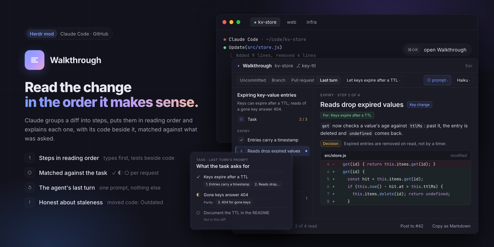

# ◆ Walkthrough

[](https://github.com/singerxt/herdr-walkthrough/actions/workflows/ci.yml)

**Read a change in the order it makes sense, not in the order of its file names.**

A [Herdr](https://herdr.dev) mod for reading what an agent, or a colleague, just wrote
before you accept it. Claude groups the diff into steps, puts them in an order where each
one builds on the last, and explains what each step changes, with its code right below.

It explains; it doesn't judge. No findings, no scores, no verdicts.

## This fork

This is Mateusz's customized fork of
[dmazlum/herdr-walkthrough](https://github.com/dmazlum/herdr-walkthrough), based on upstream
**0.8.1**. The default branch is **`blueprint-contracts`**. It includes upstream persistent
read tracking, Last turn, task mapping,
interface improvements and UTF-8 clipboard fixes. Recap stays first; Task and Contracts
follow it before the code steps. Upstream `main` is retained separately.

- **Recap first.** A summary of the change and a native blueprint of its architecture.
- **Interactive blueprint.** Source-backed component status and details, connection labels,
  evidence-based groups, and focus on a selected component and its direct connections.
  File links jump to the relevant walkthrough section.
- **Contracts.** Dedicated database, Protobuf and API pages when the diff changes those
  contracts, with before/after comparisons, compatibility impact and deployment order
  when supported by the diff.
- **Evidence per change.** Open the exact supporting diff or jump to every walkthrough
  step that explains it. Missing source and changes without a matching step are marked.
- **Selected language respected.** Contract controls and exported labels support all
  fourteen selectable languages, and generated explanations follow the selected language.

Older reports remain readable. Regenerate them to add blueprint metadata or contract pages,
or to replace explanations generated in the wrong language. Source toggles and step links
work with existing reports that already contain the required evidence.

The screenshot below shows the upstream interface; this fork adds the blueprint and Contracts.



## Quick start

You need the **Herdr desktop app 0.1.9+**, **git**, and **Claude Code** (`claude`, logged in).

1. **Install.** In Herdr, ask your agent:
   *"Add the mod github.com/singerxt/herdr-walkthrough from blueprint-contracts"*.
   To do it by hand, see [Install by hand](#install-by-hand).
2. **Open it.** Focus a terminal in a git repository and press **⌘⇧K**.
3. **Pick what to read** (Uncommitted, Branch, a Pull request, the agent's Last turn…)
   and press **Generate**. A small change costs about $0.002 with Haiku.

Then read with **←** and **→**. Want the agent's last turn written up for you, without a
click? Add the two [Last turn hooks](#last-turn).

## What you get

### A diff you can read top to bottom

- **Steps in reading order.** Related edits across files become one step. Types and entry
  points come before the code that uses them; tests sit with the code they prove. Steps
  are grouped into a few parts, listed on the left, and each one's code is shown in your
  theme's syntax colours.
- **Where to look first.** *Key change* marks the step or two the rest depends on;
  *Context* marks edits that are safe to skim.
- **Notes, only when they matter.** A step can say what you accept by taking the change:
  a *Decision* that could have gone another way, *Upkeep* the project now carries, a
  *Limitation* users still hit, a *Divergence* between two paths, or something *Untested*.
  Notes state facts; they never call code wrong.
- **Nothing hidden.** Every edit no step explains is listed under **Not covered**, with a
  line on what changed. Lockfiles and generated files aren't sent to the model, but are
  listed too.

### Any change you want to read

| Tab | What it shows |
| --- | --- |
| **Uncommitted** | Everything not committed yet: staged, unstaged and new files |
| **Staged** / **Unstaged** | One half of it |
| **Branch** | Your branch against its base, without what the base gained since |
| **Commit** | One commit |
| **Pull request** | An open pull request on GitHub, as GitHub shows it (your branch's is picked for you) |
| **Last turn** | Only what an agent changed while answering one prompt: not your edits before it, not the ones after |

### Matched against what was asked

A walkthrough opens on the **task**: each thing that was asked for, marked
✓ shown in this diff, ◐ partly, or ○ not in this diff, with links to the steps that do it.
Each step says which request it serves, and steps no request asked for are listed too.

You don't have to type the task. It's found for you: the Last turn's prompt, the pull
request's description, the commit's message, or the prompts you sent to Claude Code since
the last commit. You can also write your own, or turn it off, from the **Matched against** menu. It
says *where* a request shows up, never whether it's done well.

### Honest when the code moves on

- **Outdated, live.** Each step is tied to the exact code it explains. Edit that code and
  the step is marked **Outdated** right away; new edits show under Not covered.
  **Regenerate** keeps what's still true.
- **What you've read, remembered.** Moving past a step marks it read (`x` toggles it).
  Ticks survive closing, staging and regenerating; only a real edit makes code unread
  again. `u` shows only what's left, and on reopening you're told which steps changed
  since you read them.


### Share it, or send it back

- **Comment on any line**, then **Send** pastes your comments, with their code, into an
  agent in the same space.
- **Copy as Markdown** for a pull request description, a review or a chat. The code stays
  out (the diff is already beside it). It sits between hidden `<!-- walkthrough -->`
  marks, so a description holding one isn't read back as the task.
- **Post to #12** adds the walkthrough as a comment on the pull request, after you confirm.
  Your prompts are never posted.

### Cheap, and out of your way

- **Paid once.** Walkthroughs are cached by the exact diff, model and language. Undo a
  change and the earlier walkthrough is back, free.
- **Runs in the background.** Close the dialog, or Herdr; it's waiting when you're back.
- **Written while you wait.** With **Auto** on (the default), opening the walkthrough
  writes up the agent's last turn with Haiku if it has none yet. Open as a pane, it writes
  one each time an agent in its tab finishes, and tells you. Over 300 hunks it waits for
  Generate.
- **Your model and language.** Haiku (default), Sonnet or Opus; explanations in fourteen
  languages, starting from your system's. Code and paths stay as they are.

## Keys

| Key | What it does |
| --- | --- |
| **⌘⇧K** | Open the walkthrough of the focused terminal's repository |
| **←** **→** (or **j** **k**) | Previous / next step; moving on marks a step read |
| **x** | Mark the step read or unread |
| **u** | Unread only: step through only what you haven't read |
| **t** | The task page (**←** from the first step goes there too) |
| **Esc** | Close a picker, the task editor or a comment, then the dialog |

<details>
<summary>Menus and commands for your own keys</summary>

| Menu / command | What it does |
| --- | --- |
| **Matched against** menu | Found (default), Your own… (write it), or Off; kept per repository and tab |
| Last turn → **⚡ Auto** | On (default): write the last turn's walkthrough without a click. One click turns it off: only on Generate |
| `walkthrough.generate`, `.cancel`, `.next`, `.prev`, `.copy`, `.unread`, `.task` | Generate, cancel, move, Copy as Markdown, Unread only and write your own task |

</details>

To keep it beside an agent instead of over it, open it as a pane:

```sh
herdr-app do pane.split --direction right --mod walkthrough --props '{"scope":"branch"}'
```

## Last turn

The Last turn tab shows exactly what an agent changed while answering one prompt. It
needs two Claude Code hooks: one takes a snapshot of your working tree when you send a
prompt, the other when the agent stops. The walkthrough never edits your settings
itself. Until a turn is recorded, the tab shows these with a **Copy settings** button.

Add them to `~/.claude/settings.json`, next to any hooks you already have:

```json
{
  "hooks": {
    "UserPromptSubmit": [{ "hooks": [{ "type": "command", "command": "sh \"$HOME/.config/herdr-app/mods/walkthrough/hooks/turn.sh\" start", "timeout": 30 }] }],
    "Stop": [{ "hooks": [{ "type": "command", "command": "sh \"$HOME/.config/herdr-app/mods/walkthrough/hooks/turn.sh\" stop", "timeout": 30 }] }]
  }
}
```

Turns are recorded from the next prompt on. Pick any of the last 20 by their prompt.
(A background task's notification, which Claude Code also sends as a prompt, starts no
turn: the work it leads to counts as the turn it came in.) The
prompt goes to the model too, so the steps are explained against what was asked.

**When a turn has no clean end.** Stop a turn with Esc, or quit the agent mid-turn, and
Claude Code sends no Stop. Such a turn ends at your next prompt in that session or
terminal. If there's no next prompt, the walkthrough freezes the turn once the agent has
been quiet for 45 seconds (12 hours if it can't tell). It can only see that moment, not the
one the agent stopped at, so edits you made in between count as the turn's. These turns
are labelled *"no Stop recorded, ended when seen idle"*, and Auto leaves them for you to
Generate.

<details>
<summary>How the hooks work</summary>

[`hooks/turn.sh`](mods/walkthrough/hooks/turn.sh) needs only `sh` and `git`. It runs
`git add -A && git write-tree` against an index and an object folder of its own under
`~/.herdr/walkthrough/turns/`, so your repository's index, refs and objects are never
written, not even their modification times. New files over 1 MB are left out, as
everywhere else, and listed under Not covered. It prints nothing, and any failure is a
silent exit 0: it never holds an agent up. In a 6,000-file repository a snapshot takes
about a second.

Inside Herdr each turn records its terminal (`HC_TERMINAL_ID`), so the tab shows the turn
of the agent you opened it over, and a pane knows which turns are its tab's.

</details>

## Privacy and cost

**Nothing is sent to a model until you press Generate**, except an agent's last turn while
Auto is on (Haiku only, up to 300 hunks). Nothing is posted anywhere until you press
**Post** and confirm.

- **Opening the walkthrough only reads git.** On the Pull request tab it also asks `gh` for
  the open pull requests and the picked one's diff. For local changes and branches it reads
  what you typed into Claude Code in this repository since the last commit (from
  `~/.claude/projects/`), to find the task. Tool output, subagents and commands are left out.
- **A generation is one `claude -p` call** in the background, with no tools, MCP servers,
  settings, hooks or skills: the model only reads the diff and the task, and answers. That
  keeps a small change at about $0.002 with Haiku. Each walkthrough shows what it cost.
- **The task is treated as material, never as instructions,** and at most 6,000 characters
  of it are sent.
- **A diff too large for the model** (about 175k tokens) is refused rather than cut: a
  walkthrough of half a diff would read just as confidently as one of the whole.

<details>
<summary>What's stored, in <code>~/.herdr/walkthrough/</code></summary>

| Path | What |
| --- | --- |
| `entries/<key>.json` | Finished walkthroughs, the newest 200, each with the task it was matched against |
| `pointers/<place>.json` | The one shown last per repository and tab |
| `jobs/<place>/` | A generation in progress: its prompt, `run.sh`, and the answer |
| `turns/<repo>/<turn>/` | The last 20 turns per repository, written by `hooks/turn.sh`: the hook's input, the snapshots' trees, the objects they needed |
| `read/<repo>.json` | The hunks you've read in a repository, by content, the newest 5,000 |
| `clipboard.md` | The last walkthrough copied as Markdown |
| `pr-comment.md` | The last walkthrough posted to a pull request |
| `preferences.md` | Optional: your own wishes for tone and emphasis, added to every prompt |

A walkthrough written before 0.7.0, for something that now has a task (a commit message, a
pull request, a turn), is still shown, with a banner offering Regenerate. A walkthrough
matched against your prompts stays as it is while you keep prompting; its task page says
when more were sent since.

</details>

## Install by hand

```sh
git clone --branch blueprint-contracts https://github.com/singerxt/herdr-walkthrough
cp -R herdr-walkthrough/mods/walkthrough ~/.config/herdr-app/mods/
herdr-app check ~/.config/herdr-app/mods/walkthrough
```

Then merge [`keys.json`](keys.json) into `~/.config/herdr-app/keys.json` for **⌘⇧K**.
(Asking your agent does all of this for you: it follows [`RECIPE.md`](RECIPE.md).)

## Updating

Herdr doesn't update mods you added yourself. To hear about new versions, watch this repo
for releases (**Watch → Custom → Releases**). Each
[release](https://github.com/singerxt/herdr-walkthrough/releases) says what changed, and
whether `keys.json` did.

Your version is `"version"` in `~/.config/herdr-app/mods/walkthrough/mod.json`. To update,
ask your agent to *replace* that folder with the latest `mods/walkthrough` from
`github.com/singerxt/herdr-walkthrough`. Asking it to add the mod again isn't enough: it
would add a second copy under a new name. Or by hand:

```sh
git -C herdr-walkthrough pull          # or clone it again
rm -rf ~/.config/herdr-app/mods/walkthrough
cp -R herdr-walkthrough/mods/walkthrough ~/.config/herdr-app/mods/
herdr-app check ~/.config/herdr-app/mods/walkthrough
```

If the mod was renamed when it was added (a name clash), replace the renamed folder.

## Limits

- **Local only.** A space on another machine shows a notice.
- **Claude Code only, for now.** It must be logged in, and `claude --version` must work
  from the PATH Herdr starts programs with. Codex is planned. Comments can already be sent
  to a Codex agent, or any other.
- **Big files.** New files over 1 MB, and new files past the first 300, are listed but not
  read. A page draws at most 2,500 lines of code; the rest is counted.
- **Pull requests** need the [GitHub CLI](https://cli.github.com) (`gh`), logged in, and a
  GitHub remote. GitHub sends no diff past about 300 files or 20,000 lines; read such a
  change as a Branch instead. A pull request is read again when you pick it, not while
  it's open.
- **The task** is found from Claude Code only. Prompts sent to other agents aren't, so
  write them as your own task. For local changes it's every prompt in this repository
  since the last commit, whichever session it went to; a commit made mid-task starts it
  over. Matching is the model's reading: "not in this diff" may mean it's done in a file the
  diff doesn't hold, or under another name.
- **Last turn** records Claude Code's turns only, and writes walkthroughs without a click
  only while the walkthrough is open.
- **Comments** are kept while the walkthrough is open, and sent with Enter.
- **Read marks** are saved once a second: one made in the last second before Herdr quits
  can be lost. A step counts as changed since you read it when part of it was read, or when
  a hunk you read in its file is gone. Without an earlier walkthrough to compare with, an
  edited hunk looks new: unread, not changed.

## Roadmap

- **Auto when closed.** Write a turn's walkthrough the moment the agent stops, even with
  the walkthrough closed, from the Stop hook.
- **Codex as a model runner,** beside Haiku, Sonnet and Opus.

## Development

```sh
npm test    # parsing, hunk ids, digest, prompt, normalizing, staleness, read tracking, tasks and transcripts, Markdown export, syntax colours, gh (faked), turns, and git and turn.sh against real repos
```

While developing, copy the folder again after each change; Herdr reloads the mod within a
second. Copy, don't symlink: Herdr doesn't reload a symlinked mod folder.

```sh
cp -R mods/walkthrough ~/.config/herdr-app/mods/
```

The UI is checked in Herdr: `herdr-app check`, then `herdr-app shot` while it's open.
The README's image is [`docs/preview/index.html`](docs/preview/index.html), rendered with
`sh docs/preview/render.sh` (a headless Chromium).
[`RECIPE.md`](RECIPE.md) describes every screen and behaviour in full.

## License

MIT
