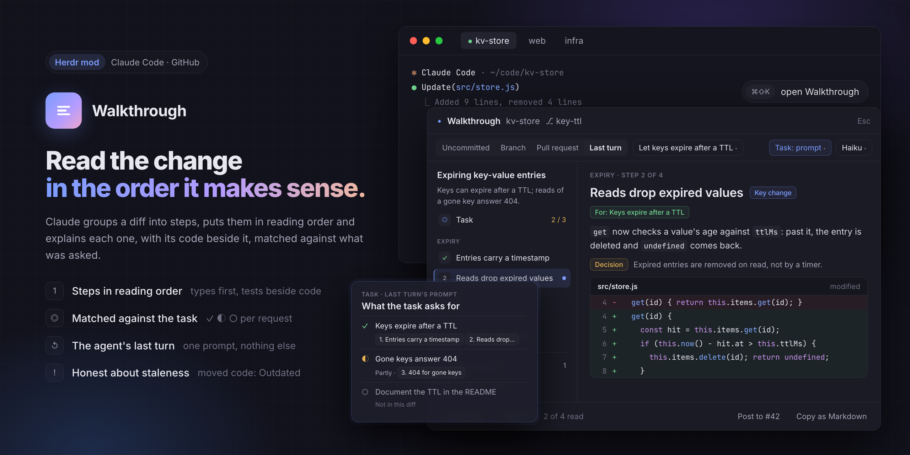

# Walkthrough

A dialog (or pane) that turns the diff of the focused terminal's repository into a guided
reading: a model (through Claude Code, or pi) groups related hunks into steps, orders them so each builds on the last, and
explains what each step changes, with the step's code under the explanation. A contents
column lists the steps; everything no step covers is listed at the end. It explains a
change and never judges it.



## Updating it (for the agent doing it)

The walkthrough offers *Update the Walkthrough mod from github.com/dmazlum/herdr-walkthrough
to its latest release* when a newer release is out. To do it:

1. Find the installed copy: the folder under `~/.config/herdr-app/mods/` whose `mod.json`
   has `"title": "Walkthrough"` (normally `walkthrough`; a different name if it was renamed
   because of a clash, and then keep that name). Its `"version"` is the one installed.
2. Take the latest release's tag from
   `https://github.com/dmazlum/herdr-walkthrough/releases/latest`, read its notes and every
   file of `mods/walkthrough` at that tag.
3. Replace the installed folder with that `mods/walkthrough`, in place: delete it and copy
   the new one under the same name. Don't add the mod again: an agent never overwrites a
   mod, so it would add a second copy under a new name.
4. Run `herdr-app check` on the folder. It must pass.
5. If the notes say `keys.json` changed, merge it into `~/.config/herdr-app/keys.json`
   again, keeping the person's own bindings.
6. Tell the person the version they now have, and what changed from the notes.

## Recap, blueprint and contracts

The first page is Recap, with a native interactive blueprint. The optional Task page
follows Recap. Components show validated change status, role and changes, source-file
navigation, connection labels and evidence-based groups. Selecting a component highlights
its direct connections; Show all clears that focus. Source-file links navigate to the
matching reading section, or to the relevant Contract or Not covered page.

Conditional database, Protobuf and API contract pages follow Recap and Task before the
code steps. Each change has a before/after comparison, its own exact source diff toggle
and links to matching walkthrough steps. Stale source and changes without a matching step
are marked. Contract and Recap labels (`lib/contract-language.js`, `lib/recap-language.js`),
in the UI and the Markdown, follow the saved report's language (not the picker's); a few
blueprint hints and the step labels are English. Generation explicitly
requests the chosen language. Existing wrong-language prose needs regeneration. Older
reports remain readable; new metadata requires regeneration.

Only steps are required of an answer. `normalize` checks the recap, blueprint and
contracts against the digest and leaves out what doesn't hold up, counting it in
`walkthrough.omitted` ({ recap, contracts }) for a note on Recap: a recap change without
a motivation or a real path; a diagram outside the subset (the blueprint goes, the
description stays); a component, connection or group without real resulting evidence; a
contract change without evidence or states to compare, and a page left with none.
Recap paths no change names go to `recap.other`; generated and unread files are listed in
the prompt (contents not sent) and count as recap paths. Aliases are read as in steps (`[h1]`,
spaces). The Mermaid subset accepts `graph`, trailing `;`, `A-->B`, unquoted `A[Label]`
and `%%` comments, and is stored in one canonical spelling without inline labels or
subgraphs: only source-backed connections and groups draw those. A repeated edge is kept
once, and an id Mermaid reserves (`end`, `click`, …) gets a trailing `_` everywhere. A report opens on Recap
while none of its steps is read, else on its first unread step.

All pages share one reading order. Persistent hunk read tracking counts only code steps;
unread-only navigation retains Recap, Task, Contracts and Not covered. The toolbar's source
and model/language controls stack at narrow widths to avoid overlapping.

## What you see

A dialog 74% of the window wide and 80% tall (`modal`), on `theme().popover`; as a pane, on
`theme().background`. Text 13px, `theme().foreground`. Top to bottom:

1. **Header**, 48px, bottom border `border`: the mark (a 22px tile, radius 7, a 135° gradient
   from `ansi4` to `ansi5` painted with `window.paint_path` and `Background.linear_gradient`,
   three white bars, the middle one shorter), "Walkthrough" 14px semibold, then a `raised`
   pill with the repository name and `⎇ branch` (or "detached") in `muted` 11.5px; at the
   right a braille spinner while the diff is read, the one action — **✦ Generate** (solid)
   with nothing exact on screen, **Regenerate** (outline) over an exact one, **Cancel**
   while one is running — and, in a dialog, a ghost "Esc" button.
2. **Toolbar**, one row (padding 8px 14px, bottom border), stacking into two below 1100px:
   on the left what to read and which one of it, on the right how it is written.
   - scope tabs in a `raised` pill (radius 9, padding 3): Uncommitted, Staged, Unstaged,
     Branch, Commit, Pull request, Last turn; 24px tall, 12px; the chosen one on `popover`,
     semibold, with a small shadow, the rest `muted`. Each has a tooltip saying what it reads.
   - after the tabs: Branch has "vs" (11px `dim`) and a dropdown of the base; Commit a
     dropdown of the commit (`short subject`); Pull request, once some are listed, a
     dropdown of the open pull requests (`#12 title`, hint "author · head → base",
     "· draft", "· this branch"); Last turn, once a turn is recorded, a dropdown
     of the turns (the prompt's first line, hint "5 min ago · took 1:20 · t3", "still
     running", "interrupted" or "no Stop recorded, ended when seen idle"), then **⚡ Auto**
     (soft: `accent` on `accent` + `1f`) / a ghost **Auto: off** that switches Auto with one
     click (tooltip: what it does).
   - right: once a diff is read, the task dropdown, soft while a task is found
     ("◎ prompt", "◎ PR description", "◎ commit message", "◎ 3 prompts", "◎ yours",
     "No task found", "No task (off)"; rows Found (hint: where it came from, or "Nothing
     found for this change"), Your own… (hint: its first line) and Off); then the model
     (Haiku, Sonnet, Opus) and language (its own name: Türkçe, Deutsch …) dropdowns as ghost
     buttons in one bordered group (radius 8) with a 1px divider. Dropdown faces end in "▾".
   - Dropdowns open a menu (12px radius, rows radius 8, `popover`, `border`, shadow) under the toolbar,
     left-aligned for base and commit, right-aligned for model and language; the chosen row
     ticked in `accent` and on `selected`; a click outside closes it. The menu is a
     `v_virtual_list` (30px rows, 44px with a hint line, at most 360px tall, a `Scrollbar`
     beside it) so the wheel scrolls it; ↑ ↓ move a highlight (`hover`) that stays in view
     through a `VirtualListScrollHandle`, Enter chooses it, Esc closes it. Clicks come
     through `on_item_click`, since virtual list rows take no handlers. The menu and the
     backdrop under it stop the wheel (`on_scroll_wheel` → `stop_propagation`), so only
     the menu scrolls while it is open.
   - **Task editor**, under the toolbar while Your own… is being written: on `raised`, a
     `muted` line (what it does, that it stays local and isn't posted), a `Textarea` (3 to
     10 rows, filled with the task found when there is no own one yet), a solid **Use this
     task**, a ghost Cancel and "120 / 6,000" (red past the limit, which disables the
     button). An empty task goes back to Found. Esc, or another source, closes it.
3. **Body**, the rest. One of:
   - an empty state, centered: a 44px icon tile (radius 12, `raised`, bordered; 19px glyph
     in `muted`, or the state's colour), a 14px title, a 12.5px `dim` line, and ghost
     buttons for what to do instead. Another machine (⇄); "Not a git repository" (⎇);
     "Couldn't read the diff" and "Couldn't list the pull requests" (! in `ansi1`, with the
     reason; the latter offers "Read it as a Branch"); "No open pull requests" (#, Branch and
     Uncommitted); "Pick the branch to compare with" / "Pick a pull request" / "Pick a
     commit" (◇); "Nothing to walk through" (✓ in `ansi2`, offering Branch and Last turn
     from Uncommitted, Uncommitted from the rest); for a turn, "Nothing to walk through yet"
     while it runs or "This turn changed no files" (↺, an "Other turns" dropdown and
     Uncommitted). While something is only being read ("Reading…", "Reading the diff…",
     "Reading the pull requests…") just the title, in `muted`, without an icon;
   - **hook help** (Last turn, no turn recorded), a 620px column: "Record the agent's
     turns" 18px semibold, one `muted` paragraph (what the hooks do), then three numbered
     steps in one bordered box (a 22px `accent` circle with the number, a 13px semibold
     title, rows divided by `border`): 1 "Copy the two hooks" with the settings in the
     terminal font on `raised`, one line per hook as the README shows them (the script path
     from `$HOME`, long lines wrapping under their own indent), a solid **Copy settings**
     (copies exactly that) and "✓ Copied" in `ansi2`; 2 "Add them to
     ~/.claude/settings.json" (next to existing hooks; the walkthrough never edits
     settings); 3 "Send your agent a prompt" (where snapshots go, the newest 20 kept);
   - **intro** (no walkthrough yet), a 620px column: "Read this change in the order it
     makes sense" 24px semibold, one 13.5px paragraph in `muted`, chips for files, hunks,
     "≈ 3k tokens" (red past the limit), "N generated, not sent", "N not read" and, with a
     task, "Task: prompt" in `accent` (tooltip: where it came from), red
     notices when `claude` is missing or the diff is too large, the solid
     "Generate walkthrough with Haiku" button and "in English", then a bordered card (radius
     12, on `surface`) listing the changed files (32px rows: path, a "generated" chip, status, `+n` in `ansi2`, `−n` in
     `ansi1`);
   - **progress** (first generation running), centered: ✓ Read the diff (N hunks), a
     spinner on "Asking Claude Haiku" with the elapsed `m:ss`, ○ Putting the steps together,
     a line saying it runs in the background, and Cancel;
   - **the walkthrough**: a 248px contents column (right border) and the page.
     - Contents, on `surface`: the title 14.5px semibold, the summary 12px `muted` (line
       height 1.55), cut at 150 characters with "…" and a "Show more" / "Show less" link in
       `accent` 11.5px; a 4px rounded meter (`accent`, `ansi2` once all is read, on `raised`)
       and "2 of 7 read" in `dim` 11px; then small-caps group labels (10.5px semibold `dim`):
       Overview (Recap, Task), Contracts, and each part's title with "1 / 2" (its steps read /
       all) at the right. Every row is 32px, radius 8: a 20px round badge, the title 12.5px,
       then any tag. The badge holds the step number in `muted` on `raised`; ✓ in `ansi2` on
       `ansi2` + `24` once read (and the title in `dim` while another page is on screen);
       `!` in `blocked` on `blocked` + `29` when outdated; the number in `accent` on `accent` +
       `29` with a tooltip when it changed since it was read; on the chosen row the number on
       solid `accent`, the row on `accent` + `1f` and its title medium. Recap's badge is "≡",
       the contract pages' "▤" (database), "{}" (Protobuf), "⇄" (API). Skim steps' titles are
       `muted`; key steps carry a "KEY" pill (9.5px semibold `accent` on `accent` + `24`,
       tooltip "Key change"). With Unread only on, "Unread only · u shows all" in `accent` 11px
       under the summary. A walkthrough matched against a task has a **Task** row: `◎` in
       `accent` on `accent` + `24`, "Task", and a "2 / 3" pill (requests shown in this diff /
       all, `ansi3` while some aren't, "—" for none). Then only the steps not read plus the one
       on screen ("Every step is read." when none). After a rule, "… Not covered" with its
       count in a pill (`accent` while some of its hunks aren't read), then "Haiku · English ·
       date · $0.002" in `dim` 10.5px. Hidden when the walkthrough is narrower than 720px.
     - Banners over the page, one shape (10px radius, a 1px border in the banner's colour +
       `40` on its colour + `12`, or on `raised` with a `border` border for a quiet one; a 20px
       round icon on the colour + `29`; the message 12px, then a `muted` 11.5px detail line;
       the action at the right): "Writing a new walkthrough with Haiku… 0:12" + Cancel
       (`accent`, "…"); an error (`ansi1`, "!"); "The code moved on since this walkthrough
       was written." with "1 step describes code that has changed or is gone." (or "3 new
       hunks are listed under Not covered.") + Regenerate (`blocked`, "!"); quiet ("i"):
       "Showing the English walkthrough by Haiku. There's none in Türkçe by Sonnet for
       this code yet." + Generate; or, when the code is the same and only the preferences or
       the prompt version changed, "This code hasn't changed, but your preferences or this
       mod's prompt have since this walkthrough was written." + Regenerate, or, when it was the
       task, "The task has changed since this walkthrough was matched against it.", "This
       walkthrough was written without a task. Regenerate to match the change against it."
       or "This walkthrough was matched against a task that is now off or gone."; and "3 steps
       changed since you last read them." + "Go →" (`accent`, "↻"), each press the next such step.
     - Notices in the page (the intro's, the task page's) are the same tinted box, without an
       icon; a `muted` one is on `raised` with a `border` border.
     - Every page scrolls with padding 20px 28px 28px and a 14px gap, and starts with a
       small-caps line (10.5px semibold `dim`, upper-cased in the report's language) over a
       22px semibold title.
     - Recap page (first): "RECAP", the walkthrough's title and summary (14px `muted`); a
       callout when details were left out; "Architecture" 15px semibold over its description
       (Markdown); the blueprint in a card (radius 12, on `surface`): a bordered zoom group
       (− · Fit · +) and a ghost "Mermaid source", then the drawing and the component
       inspector (radius 12, on `background`). The drawing is in the UI font on `background`
       with a faint dot grid: component cards (radius 12, a 3px top strip and a status pill
       in `ansi2` added / `ansi3` modified, `muted` context), wires with pill labels, dashed
       group frames with a title pill; the selected card in `accent` with a shadow. Then
       "Changes and motivations": a card per change (radius 12, on `surface`) with a 24px
       numbered circle in `accent`, the change (Markdown, medium), "MOTIVATION" and its text in
       `muted`, and a pill per file in the terminal font; files no change names in an "Other
       changes" card.
     - Task page (before the first step, with a task): "TASK · THE TURN'S PROMPT", a ghost "Show the task" / "Hide the task" at its right (the task's
       text on `raised`, line by line, and a line when the session's earlier prompts were
       given too); "What the task asks for"; one `muted` paragraph saying it
       tells where a request shows up, not whether it is done well; then a card per request
       (radius 12, on `surface`, 8px apart): a 24px round mark, ✓ `ansi2` (seen), ◐ `ansi3`
       (partly), ○ `dim` (absent), on its colour + `24`, each with a tooltip, the request
       13.5px (`muted` when absent), then a **Partly** chip or "Not in this diff", a 22px pill per step ("3. title", a click goes there),
       "and 2 hunks under Not covered" (a click goes there), **Outdated** when its code
       changed. Then "Not tied to any request" 14px semibold, a `muted` line, and a chip per
       such step. With no concrete request: a `muted` notice instead of the rows. A new
       walkthrough with a task opens here while none of its steps is read.
     - Step page: "PART · STEP 2 OF 5", at its right a small "Mark read" (outline) / "✓ Read"
       (soft) button (disabled on an outdated step); the title with tinted pills **Key change** (`accent` on `accent`
       + `14`), **Context** (on `raised`), **Outdated** (`blocked` on `blocked` + `14`);
       with a task that names requests, a chip per request the step serves, "For: Retry
       failed uploads" (`ansi2` on `ansi2` + `12`, the whole request as tooltip), or "Not
       tied to a request" on `raised`; a click on either goes to the task page; the
       explanation as Markdown (`TextView.markdown`, so `code` reads as code) 14px, line
       height 1.65, at most 820px wide; notes, up to 820px, as callouts: a card (radius 10, a
       1px border in the note's colour + `33`, on its colour + `0f`) with a pill (Decision
       `accent`, Upkeep `ansi6`, Limitation `ansi3`, Divergence `ansi5`, Untested `blocked`,
       each with a tooltip) beside 12.5px text that wraps; for an outdated step one 12px line, "1 of 2 hunks" in
       semibold `blocked` then "changed or gone · what's left is below" in `muted` ("Every
       hunk" … "regenerate to read the code as it is now" when none is left); then the code,
       when any is left.
     - Code: one bordered card (radius 10, on `background`); a 36px `raised` header per file
       with a bottom border ("▤", the path 12.5px medium, status or "renamed from x", then the
       file's `+n` and `−n` as pills, `ansi2` / `ansi1` on their colour + `1f`); a 24px hunk
       label on `surface` instead of git's `@@`
       line (which is its tooltip), divided from the lines above it: "Line 12" (where it
       starts in the new file; in the old one when nothing of it is left), "⋯ 28 lines · Line
       44" after another hunk of the same file, then git's context (the function or class)
       in the terminal font, `muted`; 21px lines in the terminal font 11.5px with a 2px left
       edge (`ansi2` added, `ansi1` removed, transparent otherwise): number (as wide as the
       largest number in the block needs, 7px a digit + 8, right-aligned, `dim`), sign (`ansi2`/`ansi1`), text unwrapped and coloured by
       `lib/highlight.js` from the theme: keywords `ansi5`, strings `ansi2`, numbers and
       constants (true, null, None …) `ansi3`, calls `ansi4`, Capitalised names `ansi6`,
       comments `dim`, the rest `foreground`. The comment style follows the extension (`#`
       for Python, Ruby, shell, YAML …, else `//` and `/* */`); Markdown, JSON, text and
       markup stay plain. Each line is coloured alone, so a comment or string spanning lines
       is only coloured on its first. Added lines on `ansi2` + `14` alpha, removed on `ansi1`
       + `14`. At most 2,500 lines per page, then "N more lines not drawn here."
     - Not covered page: "THE REST OF THE DIFF", the title, one paragraph, then a card per
       file (radius 12, on `surface`): ▶/▼,
       path, the model's note or "Generated file, not sent to the model." / "Binary file." /
       "Not read: larger than 1 MB.", status and `+n −n`; a card with hunks not read has an
       `accent` + `88` border and an "Unread" / "2 unread" chip, a read one's path is `muted`; a small
       ghost "Mark read" / "✓ Read" marks all its hunks. A card opens to its hunks; one not read
       has its hunk label in `accent` on `accent` + `1f`, starting "●".
4. **Footer** (with a walkthrough), 52px, on `surface`, top border: "← Previous" (outline;
   disabled on the first page), "Next →" (solid; the next page's title when it isn't a step:
   "Task →", "API →", "Not covered →"), a 72px meter with "2 / 5 read" ("Recap · 2 / 5 read"
   on a page that isn't a step, "End · 2 / 5 read" on Not covered), ← → as key caps
   ("to move" beside them from 900px), a ghost "Unread only" / "Show all";
   at the right, on the Pull request tab, a ghost "Post to #12", then a ghost "Copy as
   Markdown", the last send's, copy's or post's result (in `ansi2` with a ✓ when it
   worked), "Click a line to comment" or "2 comments", and with
   comments an agent dropdown ("Claude Code · t3") and a solid **Send**.

## How it behaves

- Opening reads the focused pane's folder (`focused()`, `panes()`), else the space's
  folder; `props().folder` and `props().scope` override. Nothing is generated on open.
- The diff is re-read when files change (`watchFolder` on the repo marks it dirty unless
  every changed path is in `node_modules`, in `.git` other than its index, HEAD and refs,
  or ignored by `git check-ignore`; a 1s tick re-reads) and when the scope, base, commit, model or language changes. A newer read
  wins over an older one still running.
- The walkthrough shown is the one cached for exactly this diff, model and language; else
  the one shown last for this repository and scope, with the banners above. Steps whose
  hunk ids are gone are **Outdated**; current hunks no step names go to Not covered.
- **Generate** starts a background job; the toolbar action becomes Cancel and the elapsed
  time counts each second. When the job's answer appears it is checked, stored and shown.
  Closing the dialog doesn't stop it; the next open picks the answer up. Errors show as a
  red notice: not logged in, timed out (4 minutes plus 2 seconds per hunk, at most 15),
  stopped without an answer (the process is gone), no usable steps, too large.
- Regenerating over an earlier state of the code, with the same model and language, sends
  the old walkthrough (titles and text, no hunk references) to be revised; another model or
  language writes its own.
- Steps: click one in the contents, ← → / j k / n p, or Previous/Next. Moving on from a
  step (→, Next, `walkthrough.next`) marks its hunks read; clicking in the contents marks
  nothing. `x` (or the page's button) marks the step read or unread. A different walkthrough
  opens on its first step not read.
- Read is per hunk, per repository, not per walkthrough or scope: the key is the hunk id
  without its scope (`path:digest`), so staging a hunk, switching scope or regenerating
  keeps it read, and a step of read hunks is ticked in any walkthrough. A step is read when
  all its hunks are and it isn't outdated. `u` (or `walkthrough.unread`, or the footer
  button) lists and steps through only the steps not read; back before the first stays put,
  on past the last is Not covered.
- Changed since read: a step not read now that holds a read hunk (outdated, or a new hunk
  beside read ones), or a hunk in a file where a read hunk of the walkthrough shown when
  this one was generated (`before` in the entry) is no longer in the diff.
- Comments: click a line to select it (`selection`) and open a box under it (input, Add,
  Cancel; Enter adds). A commented line shows the comment under it with ✕. Send pastes
  "Comments from reading the walkthrough of …" and one line per comment
  (`path:line` `` `code` ``: text) into the chosen agent with `hc send` (which presses
  Enter), then clears them. Agents offered: those in this space, the one the dialog opened
  over first, then the most recently active.
- **Copy as Markdown** puts the walkthrough on the clipboard (through
  `~/.herdr/walkthrough/clipboard.md` and `pbcopy`, else `wl-copy` or `xclip`): `## title`,
  the summary, a `<sub>` line (what was read · model · language · cost), then per part a
  `###` heading and its blurb, and per step "**N. title**" with · **Key change** /
  · _Context_ / · _Outdated_, its text, each note as `> **Decision:** …`, for an outdated
  step how many of its hunks changed, and its files as `` `path` +n −n ``. Then
  "### Not covered", one `- `path` (n hunks) — note` per file. No code. The footer says
  "Copied the walkthrough as Markdown." or why it couldn't.
- **Pull request** (needs `gh`): picking the tab lists the open pull requests again
  (`gh pr list --state open --limit 50 --json …`, newest update first) and keeps the picked
  one, else picks the current branch's. Its diff is `gh pr diff N --color=never`, one section
  with scope `pr`; no new files are added and the folder isn't watched (like Commit). Its
  source key is `pr:N`, not pinned to the head commit, so after a push the last walkthrough
  shows with its moved steps Outdated. gh's errors become one sentence: not installed, not
  logged in, no GitHub remote, too large ("Read it as a Branch instead"), not found.
- **Post to #12** asks first, in the footer: "Post this walkthrough as a comment on #12?
  Everyone who can see the pull request will see it." with a solid **Post** and Cancel (Esc
  cancels too). Post writes the Copy as Markdown text to
  `~/.herdr/walkthrough/pr-comment.md` and runs `gh pr comment N --body-file …`; over
  65,536 characters it refuses. The footer says "Posted the walkthrough to #12." or why not.
- Agent statuses (working, blocked, done, idle) are not shown; the agent dropdown names the
  program and the terminal.
- **Last turn** reads `~/.herdr/walkthrough/turns/<repo>/` (`<repo>`: the first 16 digits of
  `printf %s <top> | git hash-object --stdin`), watched with `watchFolder`, newest turn
  first; the turn shown is the newest of the terminal the dialog opened over, else the
  newest, until one is picked by hand. A turn is `git diff <start tree> <end tree>` with
  `GIT_ALTERNATE_OBJECT_DIRECTORIES` set to the turn's `objects/` (and the next turn's, for
  an interrupted one), one section with scope `turn`; its source key is `turn:<id>` and
  its description quotes the prompt's first line. A running turn's end is a snapshot taken
  now (into the turn's `now.index` and `objects/`), and the folder is watched as for
  Uncommitted; a finished one doesn't change with the working tree. A turn without
  `end.meta` ends at the next turn of its session or its terminal; the newest one stays
  running while its agent is `working` or `blocked`, and once it has been anything else
  (or gone from `agents()`) for 45 s (the hook timeout and 15 s), or 12 hours with no
  terminal recorded, the mod freezes it: a snapshot now, `end.meta` with `interrupted=1`,
  listed as "no Stop recorded, ended when seen idle". Turns with no session recorded are
  not one session: such a turn ends only at its terminal's next prompt. Open turns are listed again
  every 15 s. New files over 1 MB in the end snapshot (`end.big`) and not in the start's
  (`start.big`) are left out of the diff and listed "Not read: larger than 1 MB." A diff
  that finds an object missing says which is gone: the turn's folder (only the newest 20
  are kept), or, with the folder there, content the snapshot left to the repository's
  objects that `git gc` removed.
- Picking a turn pins it, unless it is the one that would be picked anyway. A pinned turn
  no longer listed (20 newer ones came) unpins: the newest is followed again.
- **Task** (`lib/task.js`): what a source is matched against, read with the diff on each
  reload. Found: a turn's prompt (unwrapped from `<hc from>`), with up to 3 earlier prompts
  of its session as context; a pull request's title and body (from the `gh pr list` call,
  which asks for `body` too), HTML comments and anything between `<!-- walkthrough -->` and
  `<!-- /walkthrough -->` left out; a commit's `git log -1 --format=%B`, trailers
  (Signed-off-by, Co-Authored-By …) and a merge's generated subject left out; for
  Uncommitted, Staged, Unstaged and Branch, the prompts typed into Claude Code in this
  repository since the last commit's committer time (Branch: the merge base's), numbered,
  oldest first. Those come from `${CLAUDE_CONFIG_DIR:-~/.claude}/projects/<path with every
  character but a letter or digit made "-">*/*.jsonl` (files touched since then; lines
  `"type":"user"` whose `"cwd":"` is the repository or below it, kept with `grep -F` before
  anything is cut, so a sibling folder sharing the prefix can't crowd them out; without
  `tool_result`, `isSidechain`, `isMeta`; an image's base64 `data` emptied, never a line
  cut; at most 4 MB in all; then compaction summaries, non-human origins, commands and
  their output dropped, each `uuid` once); and the prompts typed into pi, codex and opencode
  there (`lib/agents.js`: session files under `~/.pi/agent/sessions/` and
  `~/.codex/sessions/` written since then, whose first line's `cwd` is the repository or
  below it, read whole 4 at a time; opencode's database read-only by
  `lib/opencode-prompts.py`, which prints `{"error"}` and exits 2 when its tables aren't
  as expected, said once in a notification), read at most every 5 s; with none there, the recorded turns' prompts since
  then. Slash commands alone, "[Request interrupted …" and empty prompts are no task. At
  most 6,000 characters (2,000 per message; past that the first and the newest that fit).
  Your own: per repository and source in the prefs (`tasks`, the newest 100); the text is kept while Found or Off is picked. Off: none. A commit message git couldn't read is asked again on the next read.
  Reading a task never fails the walkthrough: one that can't be read is no task.
- With a task, the system prompt gets the task rules and the prompt a `<task>` block (and
  `<earlier>` for context) before the digest, with every `<` that starts a `task` or
  `earlier` tag inside it (spaced, upper-case, `</task` with no `>`) turned into `‹`; the
  schema requires `asks`: `{ text, hunks, coverage: seen | partly | absent }`.
  `normalize` keeps 12, maps aliases to hunk ids (dropping unknown ones), makes a request
  with no hunk found `absent` and one called absent with hunks `partly`. The cache key gets
  the task's hash only when there is a task (`taskCacheKey`), so a walkthrough without one
  keeps its key and its prompt byte for byte; a task of prompts to agents adds the constant
  `prompts`, not its words, so another prompt ("thanks", the walkthrough's own Send) leaves
  the walkthrough exact, and its task page says "Matched against the prompts as they were
  when it was written; 5 prompts sent to agents now. Regenerate to match against them too."
  The banner compares the same keys. Auto doesn't write a turn that already has a
  walkthrough written without a task. The entry keeps `task: { from, label, short, text, context,
  key }`. `overlayAsks` lays the requests over the shown diff: their steps, hunks only
  under Not covered, hunks gone (Outdated), and the steps no request names (none when
  there is no request).
- Copy as Markdown adds "### Task", the source as `<sub>`, then `- ✓ request — step 2`,
  `◐ … — partly, steps 3, 4, Not covered`, `○ … — not in this diff`, and "Not tied to any
  request: step 5." Post to #12 leaves the task out unless it came from that pull
  request's description. The whole Markdown sits between `<!-- walkthrough -->` and
  `<!-- /walkthrough -->`.
- **Auto** (`autoGenerate` in the prefs: `on-open`, the default, or `off`): on open, the
  turn the tab shows, when finished and without a walkthrough by Haiku or by the picked
  model, is written with Haiku in the background (followed to its end even when another
  turn is picked meanwhile); in a pane (`props().overlay` unset), when an agent
  of this tab (`agents()`, `tab` the pane's) goes from `working` to `done` or `idle`, its
  newest finished turn is, once its Stop hook has written `end.meta` (up to 45 s: the
  hook's 30 s timeout and 15). Never a turn the mod froze (`interrupted=1`): its end may
  hold the person's own edits, so it waits for Generate. Never past 300 hunks or the prompt limit, and once per turn per open walkthrough. A finished
  run posts `notify({ title: "Walkthrough ready", body: 'Last turn: "…"', level:
  "success" })`. `on-stop` (written with the walkthrough closed) is planned.
- Model, language, scope, Auto and each repository's base are remembered in
  `shared("walkthrough.prefs")`. The first language is the system's (`defaults read -g
  AppleLanguages`, else `$LANG`).
- Keys from `keys.json`: `cmd-shift-k` → `mod.open:walkthrough`. Mod commands:
  `walkthrough.generate`, `.cancel`, `.next`, `.prev`, `.copy`, `.unread`, `.task` (opens the task editor), `.recap`. In the view, `x`
  marks the step read or unread, `u` toggles Unread only, `t` opens the task page and `r` Recap.

## Update check

- Only the open walkthrough checks, when it opens, and at most once a day: one GET to
  `https://api.github.com/repos/dmazlum/herdr-walkthrough/releases/latest`, with no token
  and nothing about the person, their repositories or their code. Under `herdr-app check`
  it doesn't ask.
- The result is kept in Herdr's shared state under `walkthrough.update` (`checked`,
  `latest: {tag, url}`, `dismissed`, `off`, `repo`), so it lasts across restarts and every
  open copy sees it. Nothing is saved before asking: Herdr may make a view and drop it at
  once, and a request cut short with it must not count as asked (two copies open together
  may both ask, once a day). The request has 15 seconds (Herdr's `cx.timer`), then counts
  as failed. A result saved for another repository counts as never checked; `off` holds
  for any.
- A release is offered when its tag (`v1.2.3`) is newer than `VERSION` in
  `lib/update.js`, which must equal `package.json`'s and `mod.json`'s version (a test
  checks it). A tag of another shape offers nothing until the next day's check; a failed
  request or no network offers nothing and is tried again an hour later. A saved check
  time in the future (a clock that was wrong) counts as long ago.
- The strip, under the header: an "↑" in `accent`, "Walkthrough v0.10.0 is out", "you have
  0.9.0" in `dim`, a line saying to paste the prompt to the agent, a solid **Copy prompt**
  (copies it, with a "Copied" notification), and links **What changed** (opens the
  release's page only if it is on `https://github.com/dmazlum/herdr-walkthrough/`, else
  the releases page), **Later** (hides that release until a newer one) and **Stop
  checking** (sets `off` for good). `CHECK = false` in `lib/update.js` turns it off before
  it ever asks (an update puts it back).
- A release bumps the version in `package.json`, `mods/walkthrough/mod.json` and
  `VERSION` in `lib/update.js`.

## Built from

- `mods/walkthrough/mod.json`: `{ "place": "none", "title": "Walkthrough", "overlay": {
  "kind": "dialog", "modal": true, "width": 0.9, "height": 0.9 } }`.
- `main.js` (the `View`), `view.js` (state and drawing), `engine.js` (cache and job, the
  only file that touches the disk besides git), `ui.js` (button, chip, menu, dropdown face).
- `lib/` is plain JavaScript taking `exec` as an argument, tested with `node --test`:
  `hash.js` (a 53-bit string hash; no host crypto needed), `hunks.js` (unified diff → files
  and hunks; hunk id `scope:path:hash8(function name after @@ + lines)`, without the line
  numbers so a hunk that only moved keeps its id; `-2`, `-3` for identical hunks in a file), `generated.js` (lockfiles, `.min.js`, `.map`, `.generated.`, `__snapshots__` …, by
  name only), `digest.js` (`=== path (status) [scope]`, then `[h1] @@ … @@` and the lines;
  generated files left out), `prompt.js`, `walkthrough.js` (JSON schema, `normalize`,
  `parseJson`, `overlay`), `sources.js` (git), `cache.js` (keys, limits), `job.js`
  (`run.sh`, reading the answer), `languages.js`, `comments.js`, `read.js` (read keys,
  `stepRead`, `markStep`/`unmarkStep`, `prune`, `mergeRead`, `changedSince`), `task.js`
  (where a task comes from, transcripts, `resolveTask`, `taskKey`, the transcript listing
  script), `update.js` (the installed `VERSION` and the daily check for a newer release; it
  takes `shared`, `setShared` and `fetch` as arguments).
- Git, with `--no-optional-locks -c core.fsmonitor=false -c core.quotePath=false -c
  diff.autoRefreshIndex=false` and `--no-color --no-ext-diff --no-textconv
  --src-prefix=a/ --dst-prefix=b/ -M`: staged `diff --cached`, unstaged `diff` plus every
  untracked file as `diff --no-index /dev/null <file>`, branch `diff $(merge-base base
  HEAD)` plus untracked, commit `diff <first parent or empty tree> <hash>`. Base default:
  `origin/HEAD`, else origin/main, origin/master, main, master, trunk, develop.
- The job: `~/.herdr/walkthrough/jobs/<place>/` with `system.txt`, `prompt.txt`,
  `schema.json`, `meta.json` (key, model, backend, language, alias → hunk id, deadline) and
  `run.sh`, started with `exec("sh", ["-c", "nohup sh \"$0\" \"$1\" \"$2\" \"$3\" >/dev/null 2>&1 &",
  run.sh, program, model, seconds])`. The backend (`lib/job.js`; a preference, Claude Code
  by default) follows from the model, whose key is unique across backends. For Claude Code
  `run.sh` runs `"$1" -p --output-format json --tools '' --no-session-persistence
  --strict-mcp-config --setting-sources '' --disable-slash-commands --model $2
  --json-schema "$(cat schema.json)" --system-prompt "$(cat system.txt)" < prompt.txt >
  out.json 2> err.txt &`; for pi, `"$1" -p --mode json --no-tools --no-extensions --no-mcp
  --no-skills --no-context-files --no-session [--model $2]` with the schema appended to
  the system prompt (pi has no structured output). It writes `pid` and the run's
  `ps -o lstart=` as `started` (pi rewrites its process title, so a pid is trusted only
  while its start time matches), starts a watchdog beside it that kills the run after
  `seconds` (checking every 3 s and leaving with it), waits, writes `code`. Starting a job
  over a folder whose run is still alive kills that run first. Claude's answer is
  `structured_output`, else the JSON in `result`; pi's is the JSON in the text of its last
  `turn_end` event. A failed job's folder is moved to `failed/` for a day.
- Storage: `entries/<key>.json` (key: hash of version, prompt version, repo, scope, model,
  language, `preferences.md` and the path, status and hunk ids of every file the model
  reads: generated and unread files don't count), `pointers/<hash(repo, scope)>.json`,
  the newest 200 entries kept. An entry also holds `before`: the hunk ids of the walkthrough
  shown when it was asked for. `read/<hash(repo)>.json` is `{ "path:digest": ms }`, the
  newest 5,000 marks kept, written on the 1s tick when something changed: this window's
  changed keys over what is on disk now, so two windows keep each other's marks.
- `herdr`: `exec`, `hc` (`send`), `readTextFile`, `writeTextFile`, `watchFolder`, `home`,
  `appHome`, `focused`, `panes`, `spaces`, `agents`, `notify`, `shared`/`setShared`,
  `nextCommand`, `props`, `closeOverlay`, `theme`, `settings().font_family`, `checking`;
  and the host's `fetch` for the update check. Programs run:
  `git`, `claude` or `pi`, `python3` (opencode's database), `sh`, `env`, `date`, `find`, `head`, `nohup`, `kill`, `mkdir`, `rm`, `ls`, `wc`, `defaults`,
  `stat`, `grep`, `cut`, `tail`.
- `turnview.js` (the Last turn tab's state, Auto, the recorder and the hook help),
  `lib/recorder.js` (when a recorded turn starts and ends: a new prompt in a pi, codex or
  opencode session of the repository starts one, polled every 3 s while recording is on;
  several prompts seen at once share one turn; it ends once the sessions and the working
  tree have both been still for 60 s, or at the next prompt, interrupted when that came
  within 10 s of the last activity; Claude Code's sessions are left to its hooks; one
  window per repository records, by a lock under `recorders/` renewed on every look and
  taken over a minute after it lapses), `lib/turns.js` (the
  hook's JSON, `.meta` lines, the folder listing, where each turn ended, the settings
  snippet), `hooks/turn.sh`.

## Hooks for Last turn

The Last turn tab reads turns recorded by two Claude Code hooks running
`mods/walkthrough/hooks/turn.sh`. After copying the mod, **ask the person** whether to add
them; with a yes, merge these into `~/.claude/settings.json`, keeping every hook already
there (append to the `UserPromptSubmit` and `Stop` arrays, never replace them), with the
path of the installed copy (a renamed folder keeps its new name):

```json
{
  "hooks": {
    "UserPromptSubmit": [{ "hooks": [{ "type": "command", "command": "sh \"$HOME/.config/herdr-app/mods/walkthrough/hooks/turn.sh\" start", "timeout": 30 }] }],
    "Stop": [{ "hooks": [{ "type": "command", "command": "sh \"$HOME/.config/herdr-app/mods/walkthrough/hooks/turn.sh\" stop", "timeout": 30 }] }]
  }
}
```

With a no, say the tab shows the same settings and a Copy button. The mod itself never
writes the settings.

`turn.sh start` (UserPromptSubmit) ignores a prompt starting `<task-notification>` (a
background task's notification: the session's turn goes on, and its next Stop ends it
again). Otherwise it saves stdin unparsed as `start.json` in
`turns/<repo>/<seconds>-<pid>/`, snapshots the working tree and writes `start.meta`
(`tree=`, `started=`, `session=`, `terminal=$HC_TERMINAL_ID`) last; then keeps the
newest 20 turns, removing older folders with their `objects/`. Before the snapshot it
drops the `index` of every turn with an `end.meta` and of the session's earlier turns;
another session's running turn keeps its own. A failed snapshot leaves `start.json`
without `start.meta`. `turn.sh stop` (Stop) snapshots again into the session's newest turn
(found by `session=` in `start.meta`, or `session_id` in `start.json`) and writes
`end.json` and `end.meta` (`tree=`, `ended=`); a second Stop (a stop hook kept the agent
going) ends it again, later. When that newest turn has no `start.meta`, Stop writes
nothing: no older turn ends in its place. A snapshot: copy the
repository's index (`git rev-parse --git-path index`, `cp -p`) to the turn's `index` once,
then with `GIT_INDEX_FILE=<turn>/index GIT_OBJECT_DIRECTORY=<turn>/objects`, `git -c
core.fsmonitor=false add -A -- . ':(exclude,literal)<each new file over 1 MB>'` and `git
write-tree --missing-ok`, after `git update-index --force-remove` of those big files (one
that was small when the turn began is in the turn's index already). The big files go to
`start.big` / `end.big`, one per line. A copied index git can't use is deleted and the
snapshot run again without it (the mod's own snapshot of a running turn does the same,
without copying again). It prints nothing and always exits 0.

## Watch out

- `exec` stops after 30 s and 8 MiB, and `readTextFile` reads 1 MiB: the model call must
  run detached, and big untracked files are sized first (`wc -c`) and skipped over 1 MB.
- Without `--tools ''`, `--strict-mcp-config`, `--setting-sources ''` and
  `--disable-slash-commands`, `claude -p` carries the whole local setup: a one-line answer
  cost $0.30 instead of $0.0003 in testing. `--bare` would avoid it but refuses the
  subscription login.
- `writeTextFile` replaces a file only when given its current text; read it first.
- Inside a hunk every line is content: a removed `-- comment` is not a `--- a/file` header.
  Count the hunk's remaining old and new lines. Paths with spaces are not quoted in
  `diff --git`; take them from `+++ b/…` (which may end in a tab) or split the header in
  its middle.
- Don't hash a hunk's `@@ -a,b +c,d @@` numbers into its id: one added line above would
  rename every later hunk of the file and mark untouched steps Outdated.
- A key command must pass the same checks as the button (not while the diff is read, not
  with zero hunks, not twice), and the cache key is computed at send time from the model,
  language and preferences actually sent.
- A read started before a job began must not overwrite the job when it lands: count job
  changes and keep the job if the count moved.
- Size untracked files with exactly one output line per file (`-1` when unreadable), or a
  size lands on the wrong path.
- Don't name a field like a method on the same object (`this.key` hid `key(e)`).
- Scope keys: `uncommitted`, `staged`, `unstaged`, `branch:<base>...<head>` (the branch is
  re-read on every read, so a checkout makes it another walkthrough; detached is
  `HEAD@<short>`), `commit:<hash>`.
- A merge conflict comes as `diff --cc` with `@@@` hunks: list the file as "conflicted",
  unread, and skip its whole block, or its `+++` line renames the file before it.
- Uncommitted holds a file twice when it has staged and unstaged edits: key comments, the
  comment box, open cards and element ids by source, scope and path, and label the copies
  "staged" / "unstaged". Comments belong to the source they were made on; Send sends only
  the shown source's.
- A model step dropped for empty text must not claim its hunks.
- A pid file can outlive its process: signal or trust a pid only when `ps -o command=`
  shows the run's flags (`--json-schema`, `--no-session-persistence`,
  `--strict-mcp-config`, `--disable-slash-commands`).
- claude exits a moment before run.sh writes `code`: wait 3 s and look again before
  calling a job dead. Two windows may see one answer: claim the job folder with `mv`, and
  the window that loses just reads again.
- In a linked worktree `.git` is a file; also watch `git rev-parse --absolute-git-dir`
  (its index, HEAD, logs/HEAD).
- Keep new files in the order `ls-files` lists them, whatever order their diffs finish in:
  a binary new file has no `+++` line to sort by, and the order is part of the cache key.
  Re-diff a new file only when its size or modification time (`stat -c '%s %.9Y'`, else
  `stat -f '%z %Fm'`) changed.
- Size the intro's estimate from the very prompt Generate would send (preferences and the
  handed-on walkthrough included), or the button and the check disagree.
- After a checkout, re-read the bases for the new branch; detached is `HEAD` or `HEAD@…`
  only, never every name starting with HEAD.
- Showing an entry `touch`es it, so eviction (newest 200 by mtime) is least recently used.
- While a job runs, look only for `code` each second; check the folder and the process every
  fifth second. A launch whose `sh` fails reports its error rather than "stopped".
- Past the line cap, draw no more file or hunk headers either.
- A plain `overflow_y_scrollbar` box inside an absolutely placed popup neither scrolled
  with the wheel nor had a way to follow the keyboard: use a virtual list with a scroll
  handle, and give the root the focus when a picker opens so ↑ ↓ Enter reach it.
- Hand the model aliases (h1, h2 …), never ids, and drop any alias it returns that the
  digest doesn't have.
- Run git with explicit prefixes and no color: `diff.noprefix` or `color.diff=always` in a
  user's config would break the parser.
- `<mod>.<command>` reaches a copy opened after the last save of the mod; a copy reloaded
  in place by a save does not get them until it is opened again.
- A diff over 640,000 prompt characters (≈ 175k tokens) is refused, never clipped.
- Keep read marks without the scope (`staged:` / `working:` …), or staging a hunk unreads it.
  Scopes hold no colon; paths may, so the path of a key is everything before its last colon.
- Don't tick a step for being visited: an outdated step's read hunks still describe code
  that's gone. A step is read when all its hunks are and it isn't outdated.
- Write read marks by merging the keys changed here into the file as it is now; writing the
  whole record back would drop another window's marks.
- Remote spaces are not supported.
- A UserPromptSubmit hook's plain stdout is added to Claude's context: `turn.sh` must
  print nothing, errors included. Claude Code runs no Stop hook for a turn stopped with
  Esc: read such a turn up to its session's next start.
- `exec` takes no environment: run git as `exec("env", ["GIT_INDEX_FILE=…", "git", …])`.
- Hash the turns folder's key inside the repository (`cwd` its top) in the hook and the
  mod alike: outside one `git hash-object` uses SHA-1, inside a SHA-256 repository not.
- Find big new files with `xargs -0 … find -size +1048576c`, not one `stat` per file:
  thousands of untracked files would overflow the argument list.
- Don't give a snapshot the repository's objects as an alternate: git updates the
  modification time of every object (and pack) it finds again while writing. Keep them
  out of sight and write the tree with `--missing-ok`; the files the copied index already
  names point at the repository's objects, and the turn is read with both.
- Copy the index with `cp -p`: a copy with a new modification time makes git trust the
  stats of a file edited in the same second as the index was written (racy git), and a
  same-size edit is missed.
- Last turn's `on-stop` (written when the agent stops, with no walkthrough open, by
  `node bin/prewarm.mjs`) is planned and not built: the engine calls `herdr` directly.
- Claude Code is the only model runner; Codex (`codex exec` with a JSON schema) is planned
  and not built.

## Done when

- `herdr-app check ~/.config/herdr-app/mods/walkthrough` passes and `npm test` passes.
- In a repository with staged, unstaged and new files, Uncommitted lists all of them, a
  lockfile marked "generated"; Staged lists only the staged file.
- Generate shows the progress rows, then a walkthrough with a title, summary, parts and
  steps, each step's code under it, and "$0.00x" under the contents; the lockfile is under
  Not covered as "Generated file, not sent to the model."
- `herdr-app do overlay.close` during a generation, wait, reopen: the walkthrough is there
  and `~/.herdr/walkthrough/jobs/` is empty.
- Editing a file a step covers marks that step Outdated and shows the stale banner within
  a few seconds; the edit appears under Not covered; Regenerate brings a fresh walkthrough.
- Branch on a feature branch defaults to `main` and includes its commits, its uncommitted
  edits and its new files, but not commits made on `main` since.
- Commit on the root commit shows every file as added.
- Clicking a line, typing and Enter adds a comment under it; Send pastes it into the
  chosen agent.
- With the hooks added, a prompt that edits a file and adds one shows on Last turn as
  exactly those two files, not edits made before or after it; the repository's
  `.git/index` and `.git/objects` are byte for byte and time for time as they were.
- In a pane with Auto on, an agent finishing a turn brings a "Walkthrough ready"
  notification and the turn's walkthrough, by Haiku.
- → through two steps ticks them; close and reopen: the ticks are there, "2 / N read", and it
  opens on the first step not read. Stage the code: still ticked. `u` hides the read steps.
- Edit a line a read step covers and reopen: "1 step changed since you last read it." Go →
  lands on it; under Not covered the edit is "Unread". Regenerate: steps whose hunks didn't
  change are ticked at once.
- Commit on a commit with a body shows "Task: commit message"; Generate opens on the task
  page, each request with its steps, and each step says which request it serves. A merge
  of a pull request is matched against the pull request's title, not "Merge pull request
  #8 from …".
- Task → Off, Generate: no task page, no Task row, and the key and prompt are those of a
  walkthrough written before tasks existed. Task → Your own…, write one, Use this task:
  "The task has changed since …" until Regenerate.
- With local edits made after prompts to Claude Code in the repository, Uncommitted shows
  "Task: 2 prompts"; a question or "thanks" among them isn't a request.
- Post to #12 of a walkthrough matched against your own words posts no Task section;
  matched against #12's description, it does.
