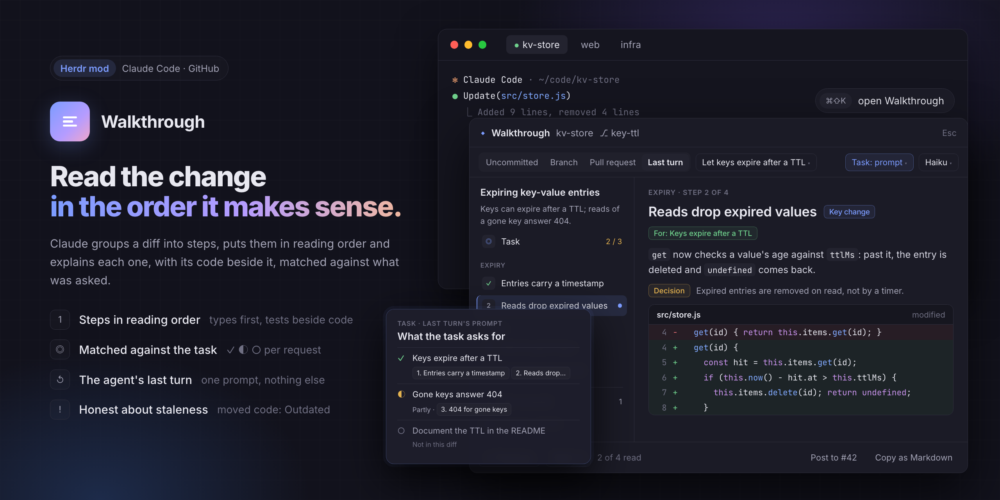

# Walkthrough

A dialog (or pane) that turns the diff of the focused terminal's repository into a guided
reading: Claude groups related hunks into steps, orders them so each builds on the last, and
explains what each step changes, with the step's code under the explanation. A contents
column lists the steps; everything no step covers is listed at the end. It explains a
change and never judges it.

## What you see

A dialog 74% of the window wide and 80% tall (`modal`), on `theme().popover`; as a pane, on
`theme().background`. Text 13px, `theme().foreground`. Top to bottom:

1. **Header**, 40px, bottom border `border`: a 12px `◆` in `accent`, "Walkthrough" 13.5px
   semibold, then the repository name and `⎇ branch` (or "(detached)") in `dim` 12px; at
   the right, in a dialog, a ghost "Esc" button.
2. **Toolbar**, at least 42px, padding 7px 14px, wrapping when narrow:
   - scope tabs in a `raised` pill (radius 7, padding 2): Uncommitted, Staged, Unstaged,
     Branch, Commit, Pull request; 22px tall, 12px; the chosen one on `popover`, semibold, the rest
     `muted`. Each has a tooltip saying what it reads.
   - Branch adds "vs" and a dropdown of the base; Commit adds a dropdown of the commit
     (`short subject`); Pull request, once some are listed, a dropdown of the open pull
     requests (`#12 title`, hint "author · head → base", "· draft", "· this branch").
   - right: a braille spinner while the diff is read, the model dropdown (Haiku, Sonnet,
     Opus), the language dropdown (its own name: Türkçe, Deutsch …), and the action:
     **Generate** (solid) with nothing exact on screen, **Regenerate** (outline) over an
     exact one, **Cancel** while one is running.
   - Dropdowns open a menu (8px radius, `popover`, `border`, shadow) under the toolbar,
     left-aligned for base and commit, right-aligned for model and language; the chosen row
     ticked in `accent` and on `selected`; a click outside closes it. The menu is a
     `v_virtual_list` (30px rows, 44px with a hint line, at most 360px tall, a `Scrollbar`
     beside it) so the wheel scrolls it; ↑ ↓ move a highlight (`hover`) that stays in view
     through a `VirtualListScrollHandle`, Enter chooses it, Esc closes it. Clicks come
     through `on_item_click`, since virtual list rows take no handlers. The menu and the
     backdrop under it stop the wheel (`on_scroll_wheel` → `stop_propagation`), so only
     the menu scrolls while it is open.
3. **Body**, the rest. One of:
   - a centered message: another machine, "Reading…", "Not a git repository.", "Pick the
     branch to compare with.", "Pick a pull request.", "Reading the pull requests…",
     "No open pull requests.", "Couldn't list the pull requests." with gh's reason, "Nothing to
     walk through." (no changes in that scope), or the git or gh error;
   - **intro** (no walkthrough yet), a 620px column: "Read this change in the order it
     makes sense" 18px semibold, one paragraph in `muted`, chips for files, hunks,
     "≈ 3k tokens" (red past the limit), "N generated, not sent" and "N not read", red
     notices when `claude` is missing or the diff is too large, the solid
     "Generate walkthrough with Haiku" button and "in English", then a bordered list of the
     changed files (26px rows: path, a "generated" chip, status, `+n` in `ansi2`, `−n` in
     `ansi1`);
   - **progress** (first generation running), centered: ✓ Read the diff (N hunks), a
     spinner on "Asking Claude Haiku" with the elapsed `m:ss`, ○ Putting the steps together,
     a line saying it runs in the background, and Cancel;
   - **the walkthrough**: a 248px contents column (right border) and the page.
     - Contents: the title 13.5px semibold, the summary 12px `muted` (line height 1.5), then
       each part's title 10px uppercase `dim` and its steps: an 18px square (radius 5) with
       the step number in `muted` on `raised`, ✓ in `ansi2` on `raised` once read, `!` in
       `blocked` on `blocked` + `29` alpha when outdated, the number in `accent` on `accent` +
       `29` with a tooltip when it changed since it was read; the title 12.5px (`muted` for skim
       steps), and a 6px `accent` dot for key steps. Every row has a 2px left border, `accent`
       on the chosen row (which is on `accent` + `1f` alpha) and transparent otherwise. With
       Unread only on, "Unread only · u shows all" in `accent` 11px under the summary, and only
       the steps not read plus the one on screen ("Every step is read." when none). After a
       rule, "… Not covered" with its count (in `accent` while some of its hunks aren't read),
       then "Haiku · English · date · $0.002" in
       `dim` 10.5px. Hidden when the walkthrough is narrower than 720px.
     - Banners over the page (7px radius, 1px border): "Writing a new walkthrough with
       Haiku… 0:12" + Cancel (`accent`); a red error; "Written for an earlier state of this
       code: 1 step describes code that has changed or is gone." + Regenerate (`blocked`);
       or "Showing the English walkthrough by Haiku. There's none in Türkçe by Sonnet for
       this code yet." + Generate; or, when the code is the same and only the preferences or
       the prompt version changed, "This code hasn't changed, but your preferences or this
       mod's prompt have since this walkthrough was written." + Regenerate; and "3 steps
       changed since you last read them." + "Go →" (`accent`), each press the next such step.
     - Page, scrolling, padding 16px 22px, gap 10: "PART · STEP 2 OF 5" 10.5px semibold
       `dim`, at its right a small ghost "Mark read" / "✓ Read" (disabled on an outdated
       step); the title 17px semibold with tinted chips **Key change** (`accent` on `accent`
       + `14`), **Context** (on `raised`), **Outdated** (`blocked` on `blocked` + `14`); the
       explanation 13.5px, line height 1.6, at most 820px wide; notes, full width up to
       820px, as a `blocked` chip on `blocked` + `12` (Decision, Upkeep, Limitation,
       Divergence, Untested, each with a tooltip) beside 12.5px `muted` text that wraps; for an outdated step "1 of the 2 hunks this step described
       changed or are gone"; the files with `+n −n`; then the code.
     - Code: one bordered block (radius 8); a 28px `raised` header per file with a bottom
       border (path semibold, status or "renamed from x"); a 20px hunk header on `hover` in
       the terminal font; 20px lines in the terminal font 11.5px: number (44px,
       right-aligned, `dim`), sign (`ansi2`/`ansi1`), text unwrapped and coloured by
       `lib/highlight.js` from the theme: keywords `ansi5`, strings `ansi2`, numbers and
       constants (true, null, None …) `ansi3`, calls `ansi4`, Capitalised names `ansi6`,
       comments `dim`, the rest `foreground`. The comment style follows the extension (`#`
       for Python, Ruby, shell, YAML …, else `//` and `/* */`); Markdown, JSON, text and
       markup stay plain. Each line is coloured alone, so a comment or string spanning lines
       is only coloured on its first. Added lines on `ansi2` + `1a` alpha, removed on `ansi1`
       + `1a`. At most 2,500 lines per page, then "N more lines not drawn here."
     - Not covered page: the title, one paragraph, then a bordered card per file: ▶/▼,
       path, the model's note or "Generated file, not sent to the model." / "Binary file." /
       "Not read: larger than 1 MB.", status and `+n −n`; a card with hunks not read has an
       `accent` border and an "Unread" / "2 unread" chip, a read one's path is `muted`; a small
       ghost "Mark read" / "✓ Read" marks all its hunks. A card opens to its hunks; one not read
       has its hunk header in `accent` on `accent` + `1f`, starting "● ".
4. **Footer** (with a walkthrough), 44px, top border: "← Previous", "Next →" ("Not
   covered →" on the last step), "2 / 5 read · ← → to move" or "End of the walkthrough ·
   2 / 5 read", a ghost "Unread only" / "Show all";
   at the right, on the Pull request tab, a ghost "Post to #12", then a ghost "Copy as
   Markdown", the last send's, copy's or post's result (in `ansi2` with a ✓ when it
   worked), "Click a line to comment" or "2 comments", and with
   comments an agent dropdown ("Claude Code · t3") and a solid **Send**.

## How it behaves

- Opening reads the focused pane's folder (`focused()`, `panes()`), else the space's
  folder; `props().folder` and `props().scope` override. Nothing is generated on open.
- The diff is re-read when files change (`watchFolder` on the repo marks it dirty unless
  every changed path is in `node_modules`, in `.git` other than its index, HEAD and refs,
  or ignored by `git check-ignore`; a 1s tick re-reads) and when the scope, base, commit, model or language changes. A newer read
  wins over an older one still running.
- The walkthrough shown is the one cached for exactly this diff, model and language; else
  the one shown last for this repository and scope, with the banners above. Steps whose
  hunk ids are gone are **Outdated**; current hunks no step names go to Not covered.
- **Generate** starts a background job; the toolbar action becomes Cancel and the elapsed
  time counts each second. When the job's answer appears it is checked, stored and shown.
  Closing the dialog doesn't stop it; the next open picks the answer up. Errors show as a
  red notice: not logged in, timed out (2 minutes plus a second per hunk, at most 15),
  stopped without an answer (the process is gone), no usable steps, too large.
- Regenerating over an earlier state of the code, with the same model and language, sends
  the old walkthrough (titles and text, no hunk references) to be revised; another model or
  language writes its own.
- Steps: click one in the contents, ← → / j k / n p, or Previous/Next. Moving on from a
  step (→, Next, `walkthrough.next`) marks its hunks read; clicking in the contents marks
  nothing. `x` (or the page's button) marks the step read or unread. A different walkthrough
  opens on its first step not read.
- Read is per hunk, per repository, not per walkthrough or scope: the key is the hunk id
  without its scope (`path:digest`), so staging a hunk, switching scope or regenerating
  keeps it read, and a step of read hunks is ticked in any walkthrough. A step is read when
  all its hunks are and it isn't outdated. `u` (or `walkthrough.unread`, or the footer
  button) lists and steps through only the steps not read; back before the first stays put,
  on past the last is Not covered.
- Changed since read: a step not read now that holds a read hunk (outdated, or a new hunk
  beside read ones), or a hunk in a file where a read hunk of the walkthrough shown when
  this one was generated (`before` in the entry) is no longer in the diff.
- Comments: click a line to select it (`selection`) and open a box under it (input, Add,
  Cancel; Enter adds). A commented line shows the comment under it with ✕. Send pastes
  "Comments from reading the walkthrough of …" and one line per comment
  (`path:line` `` `code` ``: text) into the chosen agent with `hc send` (which presses
  Enter), then clears them. Agents offered: those in this space, the one the dialog opened
  over first, then the most recently active.
- **Copy as Markdown** puts the walkthrough on the clipboard (through
  `~/.herdr/walkthrough/clipboard.md` and `pbcopy`, else `wl-copy` or `xclip`): `## title`,
  the summary, a `` line (what was read · model · language · cost), then per part a
  `###` heading and its blurb, and per step "**N. title**" with · **Key change** /
  · _Context_ / · _Outdated_, its text, each note as `> **Decision:** …`, for an outdated
  step how many of its hunks changed, and its files as `` `path` +n −n ``. Then
  "### Not covered", one `- `path` (n hunks) — note` per file. No code. The footer says
  "Copied the walkthrough as Markdown." or why it couldn't.
- **Pull request** (needs `gh`): picking the tab lists the open pull requests again
  (`gh pr list --state open --limit 50 --json …`, newest update first) and keeps the picked
  one, else picks the current branch's. Its diff is `gh pr diff N --color=never`, one section
  with scope `pr`; no new files are added and the folder isn't watched (like Commit). Its
  source key is `pr:N`, not pinned to the head commit, so after a push the last walkthrough
  shows with its moved steps Outdated. gh's errors become one sentence: not installed, not
  logged in, no GitHub remote, too large ("Read it as a Branch instead"), not found.
- **Post to #12** asks first, in the footer: "Post this walkthrough as a comment on #12?
  Everyone who can see the pull request will see it." with a solid **Post** and Cancel (Esc
  cancels too). Post writes the Copy as Markdown text to
  `~/.herdr/walkthrough/pr-comment.md` and runs `gh pr comment N --body-file …`; over
  65,536 characters it refuses. The footer says "Posted the walkthrough to #12." or why not.
- Agent statuses (working, blocked, done, idle) are not shown; the agent dropdown names the
  program and the terminal.
- Model, language, scope and each repository's base are remembered in
  `shared("walkthrough.prefs")`. The first language is the system's (`defaults read -g
  AppleLanguages`, else `$LANG`).
- Keys from `keys.json`: `cmd-shift-k` → `mod.open:walkthrough`. Mod commands:
  `walkthrough.generate`, `.cancel`, `.next`, `.prev`, `.copy`, `.unread`. In the view, `x`
  marks the step read or unread and `u` toggles Unread only.

## Built from

- `mods/walkthrough/mod.json`: `{ "place": "none", "title": "Walkthrough", "overlay": {
  "kind": "dialog", "modal": true, "width": 0.9, "height": 0.9 } }`.
- `main.js` (the `View`), `view.js` (state and drawing), `engine.js` (cache and job, the
  only file that touches the disk besides git), `ui.js` (button, chip, menu, dropdown face).
- `lib/` is plain JavaScript taking `exec` as an argument, tested with `node --test`:
  `hash.js` (a 53-bit string hash; no host crypto needed), `hunks.js` (unified diff → files
  and hunks; hunk id `scope:path:hash8(function name after @@ + lines)`, without the line
  numbers so a hunk that only moved keeps its id; `-2`, `-3` for identical hunks in a file), `generated.js` (lockfiles, `.min.js`, `.map`, `.generated.`, `__snapshots__` …, by
  name only), `digest.js` (`=== path (status) [scope]`, then `[h1] @@ … @@` and the lines;
  generated files left out), `prompt.js`, `walkthrough.js` (JSON schema, `normalize`,
  `parseJson`, `overlay`), `sources.js` (git), `cache.js` (keys, limits), `job.js`
  (`run.sh`, reading the answer), `languages.js`, `comments.js`, `read.js` (read keys,
  `stepRead`, `markStep`/`unmarkStep`, `prune`, `mergeRead`, `changedSince`).
- Git, with `--no-optional-locks -c core.fsmonitor=false -c core.quotePath=false -c
  diff.autoRefreshIndex=false` and `--no-color --no-ext-diff --no-textconv
  --src-prefix=a/ --dst-prefix=b/ -M`: staged `diff --cached`, unstaged `diff` plus every
  untracked file as `diff --no-index /dev/null <file>`, branch `diff $(merge-base base
  HEAD)` plus untracked, commit `diff <first parent or empty tree> <hash>`. Base default:
  `origin/HEAD`, else origin/main, origin/master, main, master, trunk, develop.
- The job: `~/.herdr/walkthrough/jobs/<place>/` with `system.txt`, `prompt.txt`,
  `schema.json`, `meta.json` (key, model, language, alias → hunk id, deadline) and
  `run.sh`, started with `exec("sh", ["-c", "nohup sh \"$0\" \"$1\" >/dev/null 2>&1 &",
  run.sh, model, seconds])`. `run.sh` runs `claude -p --output-format json --tools '' 
  --no-session-persistence --strict-mcp-config --setting-sources '' 
  --disable-slash-commands --model $1 --json-schema "$(cat schema.json)" --system-prompt
  "$(cat system.txt)" < prompt.txt > out.json 2> err.txt &`, writes `pid`, starts a watchdog that
  kills claude after `seconds` (checking every 3 s and leaving with it), waits, writes
  `code`. Starting a job over a folder whose run is still alive kills that run first. The answer is `structured_output`, else the JSON in `result`.
- Storage: `entries/<key>.json` (key: hash of version, prompt version, repo, scope, model,
  language, `preferences.md` and the path, status and hunk ids of every file the model
  reads: generated and unread files don't count), `pointers/<hash(repo, scope)>.json`,
  the newest 200 entries kept. An entry also holds `before`: the hunk ids of the walkthrough
  shown when it was asked for. `read/<hash(repo)>.json` is `{ "path:digest": ms }`, the
  newest 5,000 marks kept, written on the 1s tick when something changed: this window's
  changed keys over what is on disk now, so two windows keep each other's marks.
- `herdr`: `exec`, `hc` (`send`), `readTextFile`, `writeTextFile`, `watchFolder`, `home`,
  `focused`, `panes`, `spaces`, `agents`, `shared`/`setShared`, `nextCommand`, `props`,
  `closeOverlay`, `theme`, `settings().font_family`. Programs run: `git`, `claude`, `sh`,
  `nohup`, `kill`, `mkdir`, `rm`, `ls`, `wc`, `defaults`.

## Watch out

- `exec` stops after 30 s and 8 MiB, and `readTextFile` reads 1 MiB: the model call must
  run detached, and big untracked files are sized first (`wc -c`) and skipped over 1 MB.
- Without `--tools ''`, `--strict-mcp-config`, `--setting-sources ''` and
  `--disable-slash-commands`, `claude -p` carries the whole local setup: a one-line answer
  cost $0.30 instead of $0.0003 in testing. `--bare` would avoid it but refuses the
  subscription login.
- `writeTextFile` replaces a file only when given its current text; read it first.
- Inside a hunk every line is content: a removed `-- comment` is not a `--- a/file` header.
  Count the hunk's remaining old and new lines. Paths with spaces are not quoted in
  `diff --git`; take them from `+++ b/…` (which may end in a tab) or split the header in
  its middle.
- Don't hash a hunk's `@@ -a,b +c,d @@` numbers into its id: one added line above would
  rename every later hunk of the file and mark untouched steps Outdated.
- A key command must pass the same checks as the button (not while the diff is read, not
  with zero hunks, not twice), and the cache key is computed at send time from the model,
  language and preferences actually sent.
- A read started before a job began must not overwrite the job when it lands: count job
  changes and keep the job if the count moved.
- Size untracked files with exactly one output line per file (`-1` when unreadable), or a
  size lands on the wrong path.
- Don't name a field like a method on the same object (`this.key` hid `key(e)`).
- Scope keys: `uncommitted`, `staged`, `unstaged`, `branch:<base>...<head>` (the branch is
  re-read on every read, so a checkout makes it another walkthrough; detached is
  `HEAD@<short>`), `commit:<hash>`.
- A merge conflict comes as `diff --cc` with `@@@` hunks: list the file as "conflicted",
  unread, and skip its whole block, or its `+++` line renames the file before it.
- Uncommitted holds a file twice when it has staged and unstaged edits: key comments, the
  comment box, open cards and element ids by source, scope and path, and label the copies
  "staged" / "unstaged". Comments belong to the source they were made on; Send sends only
  the shown source's.
- A model step dropped for empty text must not claim its hunks.
- A pid file can outlive its process: signal or trust a pid only when `ps -o command=`
  shows the run's flags (`--json-schema`, `--no-session-persistence`,
  `--strict-mcp-config`, `--disable-slash-commands`).
- claude exits a moment before run.sh writes `code`: wait 3 s and look again before
  calling a job dead. Two windows may see one answer: claim the job folder with `mv`, and
  the window that loses just reads again.
- In a linked worktree `.git` is a file; also watch `git rev-parse --absolute-git-dir`
  (its index, HEAD, logs/HEAD).
- Keep new files in the order `ls-files` lists them, whatever order their diffs finish in:
  a binary new file has no `+++` line to sort by, and the order is part of the cache key.
  Re-diff a new file only when its size or modification time (`stat -c '%s %.9Y'`, else
  `stat -f '%z %Fm'`) changed.
- Size the intro's estimate from the very prompt Generate would send (preferences and the
  handed-on walkthrough included), or the button and the check disagree.
- After a checkout, re-read the bases for the new branch; detached is `HEAD` or `HEAD@…`
  only, never every name starting with HEAD.
- Showing an entry `touch`es it, so eviction (newest 200 by mtime) is least recently used.
- While a job runs, look only for `code` each second; check the folder and the process every
  fifth second. A launch whose `sh` fails reports its error rather than "stopped".
- Past the line cap, draw no more file or hunk headers either.
- A plain `overflow_y_scrollbar` box inside an absolutely placed popup neither scrolled
  with the wheel nor had a way to follow the keyboard: use a virtual list with a scroll
  handle, and give the root the focus when a picker opens so ↑ ↓ Enter reach it.
- Hand the model aliases (h1, h2 …), never ids, and drop any alias it returns that the
  digest doesn't have.
- Run git with explicit prefixes and no color: `diff.noprefix` or `color.diff=always` in a
  user's config would break the parser.
- `<mod>.<command>` reaches a copy opened after the last save of the mod; a copy reloaded
  in place by a save does not get them until it is opened again.
- A diff over 640,000 prompt characters (≈ 175k tokens) is refused, never clipped.
- Keep read marks without the scope (`staged:` / `working:` …), or staging a hunk unreads it.
  Scopes hold no colon; paths may, so the path of a key is everything before its last colon.
- Don't tick a step for being visited: an outdated step's read hunks still describe code
  that's gone. A step is read when all its hunks are and it isn't outdated.
- Write read marks by merging the keys changed here into the file as it is now; writing the
  whole record back would drop another window's marks.
- Remote spaces are not supported.
- Claude Code is the only model runner; Codex (`codex exec` with a JSON schema) is planned
  and not built.

## Done when

- `herdr-app check ~/.config/herdr-app/mods/walkthrough` passes and `npm test` passes.
- In a repository with staged, unstaged and new files, Uncommitted lists all of them, a
  lockfile marked "generated"; Staged lists only the staged file.
- Generate shows the progress rows, then a walkthrough with a title, summary, parts and
  steps, each step's code under it, and "$0.00x" under the contents; the lockfile is under
  Not covered as "Generated file, not sent to the model."
- `herdr-app do overlay.close` during a generation, wait, reopen: the walkthrough is there
  and `~/.herdr/walkthrough/jobs/` is empty.
- Editing a file a step covers marks that step Outdated and shows the stale banner within
  a few seconds; the edit appears under Not covered; Regenerate brings a fresh walkthrough.
- Branch on a feature branch defaults to `main` and includes its commits, its uncommitted
  edits and its new files, but not commits made on `main` since.
- Commit on the root commit shows every file as added.
- Clicking a line, typing and Enter adds a comment under it; Send pastes it into the
  chosen agent.
- → through two steps ticks them; close and reopen: the ticks are there, "2 / N read", and it
  opens on the first step not read. Stage the code: still ticked. `u` hides the read steps.
- Edit a line a read step covers and reopen: "1 step changed since you last read it." Go →
  lands on it; under Not covered the edit is "Unread". Regenerate: steps whose hunks didn't
  change are ticked at once.
